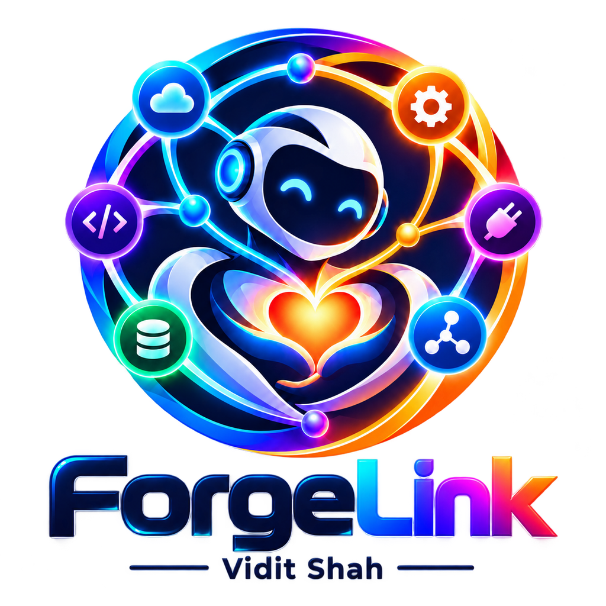
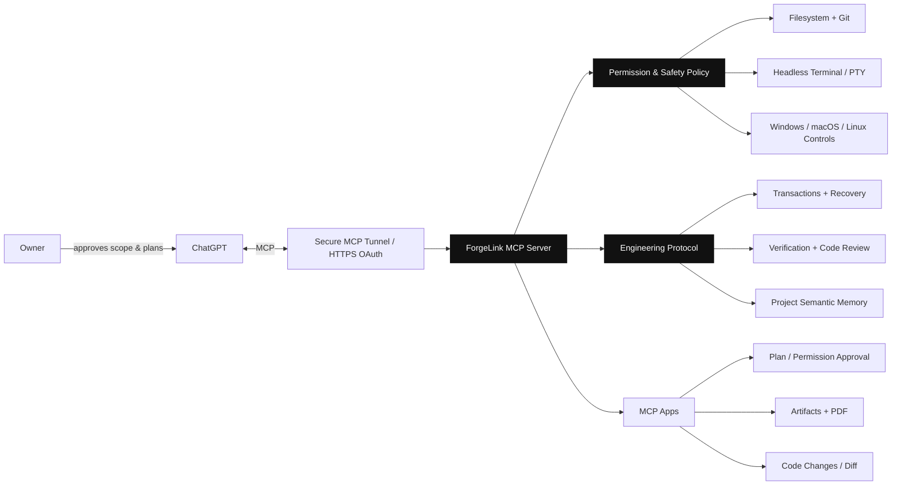
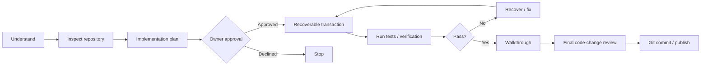
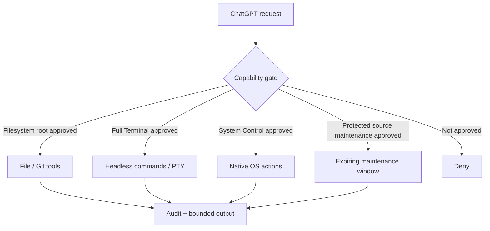

<div align="center">



# ForgeLink

### A secure local engineering bridge between ChatGPT and your computer.

**Controlled filesystem access · Git-aware coding · headless terminal execution · cross-platform system tools · recoverable engineering workflows · MCP Apps**

[](./package.json)
[](./LICENSE)
[](#platform-support)
[](https://www.electronjs.org/)
[](https://modelcontextprotocol.io/)

</div>

---

ForgeLink is a desktop and local-server bridge that gives ChatGPT **explicit, policy-controlled access** to approved files, developer tools, Git repositories, terminals, diagnostics, and selected operating-system capabilities.

The design is intentionally **ChatGPT-first**: ChatGPT remains the reasoning and coding engine. ForgeLink provides the secure local execution plane, durable engineering state, transaction safety, project memory, verification surfaces, and rich MCP Apps used to review plans, artifacts, permissions, and code changes.

> **Privacy boundary:** credentials, OAuth material, local grants, tunnel state, runtime logs, recovery data, process state, and machine-specific configuration are intentionally excluded from this repository.

## Why ForgeLink

| Capability | What it provides |
| --- | --- |
| **Controlled local files** | Read/write access only inside owner-approved roots, with read-only and temporary scopes supported. |
| **Git-native engineering** | Status, diffs, branches, staging, commits, repository discovery, and transaction-scoped code review. |
| **Recoverable edits** | Preview → apply → verify → commit flow with exact snapshots, locks, rollback, and stale-state protection. |
| **Headless terminal + PTY** | Bounded project tasks, background jobs, and persistent interactive shells under explicit Full Terminal access. |
| **Cross-platform system control** | Native Windows, macOS, and Linux adapters with platform-aware commands and safety boundaries. |
| **Code intelligence** | JavaScript/TypeScript symbols, definitions, references, callers/callees, signatures, imports/exports, rename previews, and import organization. |
| **Engineering protocol** | Durable implementation-plan approval, milestones, verification, walkthrough, and final code-change review. |
| **Project semantic memory** | Private per-project engineering context that improves continuity without running a local LLM or vector database. |
| **MCP Apps** | Rich approval, artifact, PDF/report, and Codex-style diff-review surfaces inside compatible ChatGPT hosts. |
| **Agent orchestration** | Scoped task graphs, native worker packets, bounded process access, resource budgets, and reviewed integration. |

## Architecture



### Engineering lifecycle



## Clone and run from source

### Prerequisites

- Git
- A current Node.js LTS release with npm
- Native build tooling required by Electron / `node-pty` on your platform
- Python only if you intend to build the ChatGPT plugin package
- A ChatGPT account/workspace that supports the MCP connection mode you plan to use

### 1. Clone

```bash
git clone https://github.com/viditshah5656/ForgeLink.git
cd ForgeLink
```

### 2. Install dependencies

```bash
npm ci
```

`node_modules/` is intentionally **not** stored in Git. The committed `package-lock.json` is the reproducibility source for npm dependencies.

### 3. Prepare generated assets

```bash
npm run sync:branding
npm run build:artifact-ui
node scripts/prepare-tunnel-client.mjs
```

The tunnel client and generated desktop assets are downloaded/built locally and are deliberately excluded from source control.

### 4. Start the desktop app

```bash
npm start
```

For Electron Forge development mode:

```bash
npm run dev
```

### Optional command-line/server configuration

Copy the safe template and edit it locally:

**Windows**

```bat
copy .env.example .env
```

**macOS / Linux**

```bash
cp .env.example .env
```

Never commit the resulting `.env`. The desktop application keeps its runtime configuration and encrypted secrets outside the repository.

## Build installers

Builds must run on their target operating system.

| Target | Command |
| --- | --- |
| Windows | `npm run make:win` |
| macOS | `npm run make:mac` |
| Linux | `npm run make:linux` |
| Current host | `npm run make` |

Lower-level packaging without installer creation is also available through `npm run package:win`, `npm run package:mac`, and `npm run package:linux`.

The GitHub Actions workflow in `.github/workflows/desktop-build.yml` provides repository-side build automation for supported release flows.

## Verification

Run the checks that match the work you changed:

```bash
npm run lint:desktop
npm test
npm run test:safety
npm run verify:desktop
npm run verify:target-matrix
npm run verify:platforms
```

When the local MCP server is already running, capability verification is also available through:

```bash
npm run verify
```

## Security model

ForgeLink treats local-computer access as a capability that must remain explicit, scoped, and revocable.



Core principles:

- **Least scope:** file tools are confined to approved roots.
- **Owner approval:** sensitive capabilities and implementation execution use explicit approval gates.
- **Headless-first automation:** remote keyboard/mouse/browser automation is not the default execution path.
- **No credential publication:** secrets and machine-local state are stored outside Git or ignored locally.
- **Recoverable mutation:** substantial coding changes can be previewed and applied as transactions with rollback support.
- **Current repository beats memory:** project semantic memory is advisory context; current source remains authoritative.
- **No hidden local model:** ForgeLink does not require a local LLM for the engineering workflow.

## Platform support

ForgeLink contains native platform adapters and packaging targets for:

- **Windows** — PowerShell/CMD/Git Bash/WSL discovery, Windows system controls, DPAPI-backed local secret handling, Squirrel packaging.
- **macOS** — zsh/bash/sh support, Keychain-backed Electron secure storage, DMG/ZIP packaging, native system integration where implemented.
- **Linux** — bash/sh/fish support, platform-native system/service inspection where available, Linux packaging targets.

Platform-specific operations fail closed when a capability is unavailable rather than silently executing a different operating-system command.

## Repository layout

```text
ForgeLink/
├─ desktop/                 Electron main/preload, renderer, engineering runtimes
├─ security/                permission broker and deterministic safety policy
├─ scripts/                 build, packaging, branding, verification and upgrade tools
├─ docs/                    engineering/security/architecture documentation
├─ setup-web/               browser-based setup experience
├─ web/                     local dashboard surfaces
├─ .github/workflows/       CI / desktop build automation
├─ server.mjs               ForgeLink MCP backend
├─ deep-coding-agent.mjs    engineering-agent interaction contract
├─ branding.json            canonical product branding
├─ logo.png                 canonical ForgeLink logo
├─ forge.config.cjs         Electron Forge packaging configuration
├─ package.json
└─ package-lock.json
```

Runtime folders such as `engineering/`, `recovery/`, `native-agent-runtime/`, `presentation-artifacts/`, dependency folders, downloaded binaries, and generated build output are **not part of the source distribution**.

## Connection modes

ForgeLink supports multiple local-to-ChatGPT connection strategies depending on account eligibility and deployment needs:

1. **Secure MCP Tunnel** for an outbound local connection.
2. **HTTPS Server URL + OAuth** for a public endpoint such as a Cloudflare tunnel.
3. **Loopback/no-auth development mode** only for trusted local development and verification scenarios.

Use the desktop setup flow whenever possible; it is the intended path for end users.

## Developer workflow

A typical repository change should follow:

1. Inspect workspace and Git state.
2. Read the relevant implementation and tests.
3. Create/review an implementation plan for substantial work.
4. Apply the change through a bounded, recoverable operation.
5. Inspect the exact diff.
6. Run the strongest practical tests and platform checks.
7. Produce a walkthrough.
8. Review final code changes before committing.

This repository intentionally keeps **source and reproducibility inputs**, not one developer machine's runtime state.

## Local data that must never be committed

Examples include:

- `.env` and OAuth files
- encrypted keys or `*.dpapi`
- Cloudflare tunnel tokens
- approved-root/access configuration
- tunnel/process/job/session state
- audit and safety event logs
- semantic-memory runtime stores
- recovery snapshots
- generated installers, binaries, ZIP packages, caches, and `node_modules/`

The root `.gitignore` enforces these boundaries, but always review `git status` before publishing.

## Documentation

- [ForgeLink Engineering Protocol](./docs/FORGELINK-ENGINEERING-PROTOCOL.md)
- [ChatGPT Permissions Plan](./docs/CHATGPT-PERMISSIONS-PLAN.md)
- [Windows Control](./docs/FORGELINK-WINDOWS-CONTROL.md)
- [LLM / Subagent Architecture](./docs/LLM-SUBAGENT-ARCHITECTURE.md)
- [Deep Coding Agent Contract](./DEEP-CODING-AGENT.md)

## License

ForgeLink is released under the [MIT License](./LICENSE).

<div align="center">

**ForgeLink 4.1.3 · Built by Vidit Shah**

Secure local capability. Explicit human control. Reproducible engineering.

</div>
